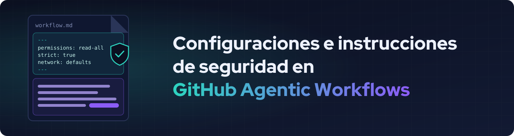
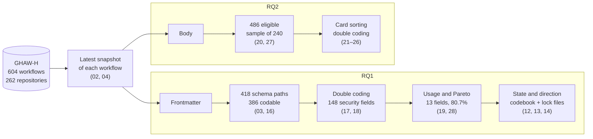

<div align="center">



[Español](README.md) · **English**

<br>

[](https://doi.org/10.5281/zenodo.24069397)
[](https://doi.org/10.5281/zenodo.22084012)
[](https://www.python.org/)
[](LICENSE)
[](https://creativecommons.org/licenses/by/4.0/)

[](results/04_dataset_overview/)
[](results/04_dataset_overview/)
[](results/19_rq1_security_field_usage/summary.csv)
[](results/17_rq1_intercoder_agreement/rows_191-386/agreement.csv)
[](results/20_rq2_pilot_sample/)

### Keep or change the defaults?

Replication package of a study on how developers configure security in the **frontmatter**<br>
and write **defensive instructions** in the **body** of GH-AW workflows.

**Camille Elgueta · Carlos Pradenas**<br>
<sub>ICC760 Applied Research in Computer Science · Universidad de La Frontera</sub>

[**Findings**](#findings) ·
[**Method**](#method) ·
[**Reproduce**](#reproducing-the-analysis) ·
[**Cite**](#licenses-and-citation)

</div>

> [!NOTE]
> The paper is written in Spanish. The coding sheets, codebooks and the coding guide are in Spanish, and the RQ1 codebook (`coding/rq1_codebook.yaml`) and all scripts are in English.

---

## Research questions

| | Question |
|---|---|
| **RQ1** | Which frontmatter security configurations do developers keep at their default value, which do they change, and in which direction? |
| **RQ2** | Which defensive instructions do developers write in the body of GH-AW Markdown files, outside the official frontmatter configurations? |

## Findings

<table>
  <tr>
    <td width="25%" align="center"><h2>1,756 / 2,262</h2>changes broaden the agent's capabilities<br><sub><a href="results/14_rq1_measurement/direction_summary.csv">direction_summary.csv</a></sub></td>
    <td width="25%" align="center"><h2>39</h2>workflows disable the role check with <code>on.roles: all</code><br><sub><a href="results/14_rq1_measurement/measurement.csv">measurement.csv</a></sub></td>
    <td width="25%" align="center"><h2>1 of 13</h2>fields has its default declared in the JSON Schema<br><sub><a href="results/03_schema_fields/fields.csv">fields.csv</a></sub></td>
    <td width="25%" align="center"><h2>2</h2>workflows grant repository write access in <code>permissions</code><br><sub><a href="results/14_rq1_measurement/direction_summary.csv">direction_summary.csv</a></sub></td>
  </tr>
</table>

- In 10 of the 13 fields analysed, most workflows do not declare the field and rely on its default value.
- In `permissions`, 573 of 592 changes are more permissive, but almost all of them broaden read (416) or authentication (155) access.
- The schema, the documentation and the lock files do not always agree. Without `tools.bash`, the documentation says only safe commands are allowed, but in 368 of 386 workflows the lock file does not restrict commands.
- **RQ2:** 46 of the 240 sampled workflows (19.2%) contain at least one defensive instruction in the body.

### State and direction of the 13 fields (RQ1)

| Field | Impl. | Equal | Mod. | Undet. | +Perm. | +Restr. | No dir. |
|---|---:|---:|---:|---:|---:|---:|---:|
| `permissions` | 3 | 8 | 592 | 0 | 573 | 0 | 19 |
| `tools.github` | 177 | 77 | 349 | 0 | 128 | 95 | 126 |
| `network` | 249 | 113 | 241 | 0 | 205 | 12 | 24 |
| `safe-outputs.add-comment` | 369 | 0 | 234 | 0 | 234 | 0 | 0 |
| `tools.bash` | 386 | 6 | 211 | 0 | 140 | 1 | 70 |
| `safe-outputs.create-issue` | 424 | 0 | 178 | 1 | 122 | 0 | 56 |
| `safe-outputs.create-pull-request` | 439 | 0 | 164 | 0 | 164 | 0 | 0 |
| `strict` | 439 | 146 | 18 | 0 | 18 | 0 | 0 |
| `safe-outputs.noop` | 453 | 50 | 100 | 0 | 0 | 98 | 2 |
| `safe-outputs.add-labels` | 482 | 0 | 121 | 0 | 121 | 0 | 0 |
| `tools.web-fetch` | 486 | 0 | 12 | 105 | 12 | 0 | 0 |
| `tools.edit` | 525 | 75 | 0 | 3 | 0 | 0 | 0 |
| `on.roles` | 528 | 33 | 42 | 0 | 39 | 3 | 0 |

<sub>Impl.: not declared. Equal: declared with its default value. Mod.: declared with another value. Undet.: declared, with no determinable default for that workflow. +Perm. / +Restr.: more permissive / more restrictive change. No dir.: no source supports a direction, or the change broadens some capabilities and restricts others. N = 603. Source: <a href="results/14_rq1_measurement/">results/14_rq1_measurement/</a>. Defaults, rules and sources for each field: <a href="coding/rq1_codebook.yaml">coding/rq1_codebook.yaml</a>.</sub>

### Defensive instructions (RQ2)

Of the 240 sampled workflows, 46 (19.2%, 95% CI 14.7–24.6%) contain at least one defensive instruction. Counting each copy group once, 46 of 224 distinct bodies (20.5%). Agreement between coders on their presence was κ = 0.902 in the pilot (workflows 1 to 30) and κ = 0.828 in workflows 31 to 70. The instructions fall into four categories: restrict actions on content (29), do not treat content as commands (21), restrict disclosure of sensitive information (5) and delimit activation commands (4). A workflow may have more than one category. Sources: [results/22_rq2_summary/](results/22_rq2_summary/) and [results/25_rq2_intercoder_agreement/](results/25_rq2_intercoder_agreement/).

---

## Method



- **RQ1.** Two coders independently classified the 386 first- and second-level paths of the GH-AW JSON Schema (κ = 0.911 in calibration and κ = 0.702 on the remaining 196 paths). Declarations were grouped into measurement units following the granularity rules of the [coding guide](coding/rq1_security_coding_guide.md), and the 13 units that account for 80.7% of the 3,566 declarations were selected. For each one, the codebook sets the default with its source (schema, documentation, lock files or GH-AW source code) and the state and direction rules.
- **RQ2.** From the 486 workflows with instructions in the body, a random sample of 240 was drawn (seed 42). Defensive instructions were analysed with card sorting: open in a 30-workflow pilot, then assigning each instruction to the resulting categories.

---

## Package layout

```
.
├── scripts/            # Scripts numbered in order of creation
├── results/            # One folder per script, each with provenance.json
├── coding/             # Codebooks, guide, coder sheets and consensus
├── config/
│   └── settings.yaml   # Pinned versions, seeds and criteria
├── docs/               # README banner
├── data/raw/           # Downloaded inputs (not tracked in git)
├── requirements.txt
├── AI_USAGE.md
└── LICENSE
```

| Group | Scripts | What they do |
|---|---|---|
| Common | 01, 02, 03, 04 | Dataset download, frontmatter keys, schema fields and dataset overview |
| RQ1 | 10, 11, 12, 13, 14, 15 | Schema roots, security architecture fields, lock file evidence (including the engine and the default of `tools.edit` and `tools.web-fetch`) and state and direction measurement |
| RQ1 | 16, 17, 18 | Security field coding: paths to code, intercoder agreement and consensus sheet |
| RQ1 | 19, 28 | Security field usage and Pareto with the granularity rules |
| RQ2 | 20, 21, 22, 23 | Sample, coding sheet, coding summary and workflow families |
| RQ2 | 24, 25, 26, 27 | Second coder materials, intercoder agreement, consensus sheet and sample size |

Script 28 belongs to RQ1.

---

## Reproducing the analysis

### Environment

Requires **Python 3.13**.

```bash
git clone https://github.com/xhandlr/ghaw-security-adoption.git
cd ghaw-security-adoption
git checkout v1.0.0
python3.13 -m venv .venv
source .venv/bin/activate        # On Windows: .venv\Scripts\activate
pip install -r requirements.txt
```

### Inputs

| Input | Source | Pinned version |
|---|---|---|
| GHAW-H (5 Parquet files) | [DOI 10.5281/zenodo.22084012](https://doi.org/10.5281/zenodo.22084012) | v0.1.2 (Hugging Face rev. `9ccc840`) |
| gh-aw schema | [github/gh-aw](https://github.com/github/gh-aw) | commit `5ecd40a4` |
| gh-aw architecture page | [github/gh-aw](https://github.com/github/gh-aw) | commit `5ecd40a4` |

Inputs are downloaded to `data/raw/`: the dataset by script `01`, the schema by `03`, the architecture page by `11` and a gh-aw clone by `19`. These scripts need an internet connection. The rest of the analysis runs locally.

<details>
<summary><b>Parquet checksums (SHA-256)</b></summary>

<br>

| File | Hash |
|---|---|
| `lock_file_snapshot.parquet` | `0272d5b7b7e93d26d52116214dd167b5f3940d135f75474092e06bb434df77b3` |
| `repository.parquet` | `75bc7e5a838281f49403e682709775936568f781031ef94b01bec343148c6ae8` |
| `source_markdown_file_history.parquet` | `5c90e748b8e5ad59de088111ea91af6b06ec08789d70e0a7600e9273ca5a02a4` |
| `source_markdown_file_snapshot.parquet` | `b8049b2f05bdbce449f24dfef3ca70e1b135b339a17347ad9d88a98f4e8d94b9` |
| `source_markdown_file_version.parquet` | `88576175db0645f52f399279d6e263f35fc2c152fbc18f734f2eb28c05cc1b2f` |

</details>

### Run order

<details open>
<summary><b>Commands, from the repository root</b></summary>

<br>

```bash
# Data (needs a connection; downloads GHAW-H to data/raw/)
python scripts/01_load_dataset.py

# Common
python scripts/02_list_frontmatter_keys.py
python scripts/03_extract_schema_fields.py     # downloads the gh-aw schema (pinned commit)
python scripts/04_dataset_overview.py

# RQ1
python scripts/10_rq1_schema_roots.py
python scripts/11_rq1_arch_doc_fields.py       # downloads the architecture page (pinned commit)
python scripts/12_rq1_lock_evidence.py
python scripts/13_rq1_lock_evidence_summary.py
python scripts/14_rq1_measurement.py           # uses the outputs of scripts 12 and 13
python scripts/15_rq1_candidate_fields.py
python scripts/16_rq1_security_field_candidates.py
python scripts/17_rq1_intercoder_agreement.py 1 190
python scripts/17_rq1_intercoder_agreement.py 191 270
python scripts/17_rq1_intercoder_agreement.py 271 386
python scripts/17_rq1_intercoder_agreement.py 191 386
python scripts/19_rq1_security_field_usage.py  # uses a gh-aw clone in data/raw/gh-aw (creates it if missing)
python scripts/28_rq1_security_field_pareto.py # needs the outputs of script 19

# RQ2
python scripts/20_rq2_pilot_sample.py          # regenerates coding/pilot_sample/ (identical, fixed seed)
python scripts/23_rq2_workflow_families.py
python scripts/22_rq2_summary.py               # uses an output of script 23
python scripts/25_rq2_intercoder_agreement.py
python scripts/27_rq2_sample_size.py
```

</details>

Pinned parameters (commits, seeds and criteria) are in `config/settings.yaml`.

> [!NOTE]
> Scripts 18, 21, 24 and 26 do not need to be run again. Scripts 18 and 26 generated the consensus sheets and stop if they already exist. Scripts 21 and 24 prepared the coding sheets. Their outputs are already in `coding/` and `results/`.

### What is and is not reproducible

- **Reproducible with code:** every result in `results/`, from the inputs and the sheets in `coding/`.
- **Delivered as data:** the manual coding, that is, each coder's sheet, the consensus decisions and the codebooks that guide them.

Each coder's sheet (`coding/rq1_security_coding_coder*.csv`, `coding/rq2_coding_coder*.csv`) is not modified after coding. Consensus is recorded in separate files, so each coder's independent classification is preserved.

---

## Licenses and citation

- **Code:** [MIT](LICENSE)
- **Results** (`results/`, `coding/`): [CC BY 4.0](https://creativecommons.org/licenses/by/4.0/), except third-party content.
- **GHAW-H data:** the Parquet files are not redistributed. The bodies in `coding/pilot_sample/` and the phrases quoted in the sheets are third-party workflow text: they are included only to allow the coding to be checked, and keep the license of their source repository.

**AI usage:** see [AI_USAGE.md](AI_USAGE.md).

### Cite this package

```bibtex
@software{elgueta_ghaw_security_2026,
  author    = {Elgueta, Camille and Pradenas, Carlos},
  title     = {Configuraciones e instrucciones de seguridad en GitHub Agentic Workflows: paquete de réplica},
  year      = {2026},
  publisher = {Zenodo},
  version   = {v1.0.0},
  doi       = {10.5281/zenodo.24069397}
}
```

### Cite GHAW-H

```bibtex
@dataset{valenzuela_toledo_ghaw_h_2026,
  author    = {Valenzuela-Toledo, Pablo and Kehrer, Timo and Panichella, Sebastiano},
  title     = {{GHAW-H}: A Dataset of GitHub Agentic Workflow Histories},
  year      = {2026},
  publisher = {Zenodo},
  version   = {v0.1.2},
  doi       = {10.5281/zenodo.22084012}
}
```
