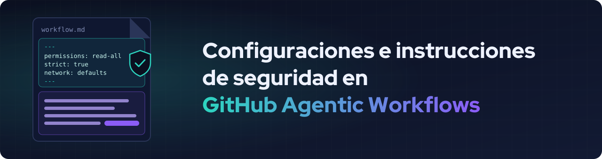
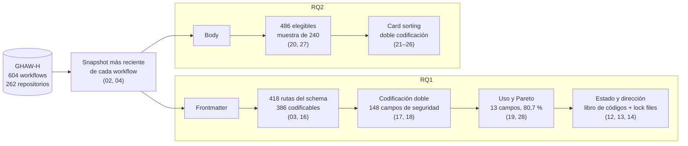

<div align="center">



**Español** · [English](README.en.md)

<br>

[](https://doi.org/10.5281/zenodo.23176659)
[](https://doi.org/10.5281/zenodo.22084012)
[](https://www.python.org/)
[](LICENSE)
[](https://creativecommons.org/licenses/by/4.0/)

[](results/04_dataset_overview/)
[](results/04_dataset_overview/)
[](results/19_rq1_security_field_usage/summary.csv)
[](results/17_rq1_intercoder_agreement/rows_191-386/agreement.csv)
[](results/20_rq2_pilot_sample/)

### ¿Mantener o modificar los valores por defecto?

Paquete de réplica del estudio sobre cómo los desarrolladores configuran la seguridad<br>
en el **frontmatter** y escriben **instrucciones defensivas** en el **body** de los workflows de GH-AW.

**Camille Elgueta · Carlos Pradenas**<br>
<sub>ICC760 Investigación Aplicada en Informática · Universidad de La Frontera</sub>

[**Hallazgos**](#hallazgos) ·
[**Método**](#método) ·
[**Reproducir**](#reproducir-el-análisis) ·
[**Citar**](#licencias-y-cómo-citar)

</div>

---

## Preguntas de investigación

| | Pregunta |
|---|---|
| **RQ1** | ¿Qué configuraciones de seguridad del frontmatter mantienen los desarrolladores en su valor por defecto, cuáles modifican y en qué dirección? |
| **RQ2** | ¿Qué instrucciones defensivas incorporan los desarrolladores en el body de los archivos Markdown de GH-AW, fuera de las configuraciones oficiales del frontmatter? |

## Hallazgos

<table>
  <tr>
    <td width="25%" align="center"><h2>1.756 / 2.262</h2>modificaciones amplían las capacidades del agente<br><sub><a href="results/14_rq1_measurement/direction_summary.csv">direction_summary.csv</a></sub></td>
    <td width="25%" align="center"><h2>39</h2>workflows desactivan el chequeo de roles con <code>on.roles: all</code><br><sub><a href="results/14_rq1_measurement/measurement.csv">measurement.csv</a></sub></td>
    <td width="25%" align="center"><h2>1 de 13</h2>campos tiene su valor por defecto declarado en el JSON Schema<br><sub><a href="results/03_schema_fields/fields.csv">fields.csv</a></sub></td>
    <td width="25%" align="center"><h2>2</h2>workflows otorgan escritura sobre el repositorio en <code>permissions</code><br><sub><a href="results/14_rq1_measurement/direction_summary.csv">direction_summary.csv</a></sub></td>
  </tr>
</table>

- En 10 de los 13 campos analizados, la mayoría de los workflows no declara el campo y depende de su valor por defecto.
- En `permissions`, 573 de 592 modificaciones son más permisivas, pero casi todas amplían lectura (416) o autenticación (155).
- El schema, la documentación y los lock files no siempre coinciden. Sin declarar `tools.bash`, la documentación indica que solo se permiten comandos seguros, pero en 368 de 386 workflows el lock file no restringe los comandos.
- **RQ2 en curso:** la codificación de la muestra de 240 workflows aún no termina. Los resultados del piloto están más abajo.

### Estado y dirección de los 13 campos (RQ1)

| Campo | Impl. | Igual | Modif. | Indet. | +Perm. | +Estr. | Sin dir. |
|---|---:|---:|---:|---:|---:|---:|---:|
| `permissions` | 3 | 8 | 592 | 0 | 573 | 0 | 19 |
| `tools.github` | 177 | 77 | 349 | 0 | 128 | 95 | 126 |
| `network` | 249 | 113 | 241 | 0 | 205 | 12 | 24 |
| `safe-outputs.add-comment` | 369 | 0 | 234 | 0 | 234 | 0 | 0 |
| `tools.bash` | 386 | 6 | 211 | 0 | 140 | 1 | 70 |
| `safe-outputs.create-issue` | 424 | 0 | 178 | 1 | 122 | 0 | 56 |
| `safe-outputs.create-pull-request` | 439 | 0 | 164 | 0 | 164 | 0 | 0 |
| `strict` | 439 | 146 | 18 | 0 | 18 | 0 | 0 |
| `safe-outputs.noop` | 453 | 50 | 100 | 0 | 0 | 98 | 2 |
| `safe-outputs.add-labels` | 482 | 0 | 121 | 0 | 121 | 0 | 0 |
| `tools.web-fetch` | 486 | 0 | 12 | 105 | 12 | 0 | 0 |
| `tools.edit` | 525 | 75 | 0 | 3 | 0 | 0 | 0 |
| `on.roles` | 528 | 33 | 42 | 0 | 39 | 3 | 0 |

<sub>Impl.: no declarado. Igual: declarado con su valor por defecto. Modif.: declarado con otro valor. Indet.: declarado, sin default determinable para ese workflow. +Perm. / +Estr.: modificación más permisiva / más estricta. Sin dir.: sin fuente que respalde una dirección, o amplía unas capacidades y restringe otras. N = 603. Fuente: <a href="results/14_rq1_measurement/">results/14_rq1_measurement/</a>. Defaults, reglas y fuentes de cada campo: <a href="coding/rq1_codebook.yaml">coding/rq1_codebook.yaml</a>.</sub>

### Piloto de RQ2

En los primeros 30 workflows de la muestra, 7 contienen al menos una instrucción defensiva. El acuerdo entre codificadores sobre su presencia fue κ = 0,902 (29 de 30). Las instrucciones se agrupan en cuatro categorías: no tratar el contenido como órdenes, restringir acciones sobre el contenido, restringir la divulgación de información sensible y delimitar comandos de activación. Fuentes: [results/22_rq2_pilot_summary/](results/22_rq2_pilot_summary/) y [results/25_rq2_intercoder_agreement/](results/25_rq2_intercoder_agreement/).

---

## Método



- **RQ1.** Dos codificadores clasificaron de forma independiente las 386 rutas de primer y segundo nivel del JSON Schema de GH-AW (κ = 0,911 en la calibración y κ = 0,702 en las 196 rutas restantes). Las declaraciones se agruparon en unidades de medición según las reglas de granularidad de la [guía de codificación](coding/rq1_security_coding_guide.md), y se seleccionaron las 13 que acumulan el 80,7 % de las 3.566 declaraciones. Para cada una, el libro de códigos fija el valor por defecto con su fuente (schema, documentación, lock files o código de GH-AW) y las reglas de estado y dirección.
- **RQ2.** De los 486 workflows con instrucciones en el body se tomó una muestra aleatoria de 240 (semilla 42). Las instrucciones defensivas se analizaron con card sorting: abierto en un piloto de 30 workflows, y luego asignando cada instrucción a las categorías obtenidas.

---

## Organización del paquete

```
.
├── scripts/            # Scripts numerados por orden de creación
├── results/            # Una carpeta por script, cada una con provenance.json
├── coding/             # Libros de códigos, guía, planillas de codificadores y consenso
├── config/
│   └── settings.yaml   # Versiones fijadas, semillas y criterios
├── docs/               # Banner del README
├── data/raw/           # Insumos descargados (no versionados en git)
├── requirements.txt
├── AI_USAGE.md
└── LICENSE
```

| Grupo | Scripts | Qué hacen |
|---|---|---|
| Comunes | 01, 02, 03, 04 | Descarga del dataset, claves del frontmatter, campos del schema y descripción del dataset |
| RQ1 | 10, 11, 12, 13, 14, 15 | Raíces del schema, campos de la arquitectura de seguridad, evidencia de los lock files (incluido el motor y el default de `tools.edit` y `tools.web-fetch`) y medición de estado y dirección |
| RQ1 | 16, 17, 18 | Codificación de campos de seguridad: rutas a codificar, acuerdo entre codificadores y planilla de consenso |
| RQ1 | 19, 28 | Uso de los campos de seguridad y Pareto con las reglas de granularidad |
| RQ2 | 20, 21, 22, 23 | Muestra, planilla de codificación, resumen del piloto y familias de workflows |
| RQ2 | 24, 25, 26, 27 | Materiales del segundo codificador, acuerdo entre codificadores, planilla de consenso y tamaño de muestra |

El script 28 pertenece a RQ1 aunque viene después de los de RQ2, porque los scripts se numeran en el orden en que se crearon.

---

## Reproducir el análisis

### Entorno

Requiere **Python 3.13**.

```bash
git clone https://github.com/xhandlr/ghaw-security-adoption.git
cd ghaw-security-adoption
git checkout v0.2.0
python3.13 -m venv .venv
source .venv/bin/activate        # En Windows: .venv\Scripts\activate
pip install -r requirements.txt
```

### Datos de entrada

| Insumo | Fuente | Versión fijada |
|---|---|---|
| GHAW-H (5 Parquet) | [DOI 10.5281/zenodo.22084012](https://doi.org/10.5281/zenodo.22084012) | v0.1.2 (Hugging Face rev. `9ccc840`) |
| Schema de gh-aw | [github/gh-aw](https://github.com/github/gh-aw) | commit `5ecd40a4` |
| Página de arquitectura de gh-aw | [github/gh-aw](https://github.com/github/gh-aw) | commit `5ecd40a4` |

Los insumos se descargan en `data/raw/`: el dataset con el script `01`, el schema con el `03`, la página de arquitectura con el `11` y un clon de gh-aw con el `19`. Esos scripts requieren conexión a internet. El resto del análisis se ejecuta en local.

<details>
<summary><b>Verificación de los Parquet (SHA-256)</b></summary>

<br>

| Archivo | Hash |
|---|---|
| `lock_file_snapshot.parquet` | `0272d5b7b7e93d26d52116214dd167b5f3940d135f75474092e06bb434df77b3` |
| `repository.parquet` | `75bc7e5a838281f49403e682709775936568f781031ef94b01bec343148c6ae8` |
| `source_markdown_file_history.parquet` | `5c90e748b8e5ad59de088111ea91af6b06ec08789d70e0a7600e9273ca5a02a4` |
| `source_markdown_file_snapshot.parquet` | `b8049b2f05bdbce449f24dfef3ca70e1b135b339a17347ad9d88a98f4e8d94b9` |
| `source_markdown_file_version.parquet` | `88576175db0645f52f399279d6e263f35fc2c152fbc18f734f2eb28c05cc1b2f` |

</details>

### Orden de ejecución

<details open>
<summary><b>Comandos, desde la raíz del repo</b></summary>

<br>

```bash
# Datos (requiere conexión; descarga GHAW-H en data/raw/)
python scripts/01_load_dataset.py

# Comunes
python scripts/02_list_frontmatter_keys.py
python scripts/03_extract_schema_fields.py     # descarga el schema de gh-aw (commit fijado)
python scripts/04_dataset_overview.py

# RQ1
python scripts/10_rq1_schema_roots.py
python scripts/11_rq1_arch_doc_fields.py       # descarga la página de arquitectura (commit fijado)
python scripts/12_rq1_lock_evidence.py
python scripts/13_rq1_lock_evidence_summary.py
python scripts/14_rq1_measurement.py           # usa las salidas de los scripts 12 y 13
python scripts/15_rq1_candidate_fields.py
python scripts/16_rq1_security_field_candidates.py
python scripts/17_rq1_intercoder_agreement.py 1 190
python scripts/17_rq1_intercoder_agreement.py 191 270
python scripts/17_rq1_intercoder_agreement.py 271 386
python scripts/17_rq1_intercoder_agreement.py 191 386
python scripts/19_rq1_security_field_usage.py  # usa un clon de gh-aw en data/raw/gh-aw (lo crea si falta)
python scripts/28_rq1_security_field_pareto.py # requiere las salidas del script 19

# RQ2
python scripts/20_rq2_pilot_sample.py          # regenera coding/pilot_sample/ (idéntico, semilla fija)
python scripts/22_rq2_pilot_summary.py
python scripts/23_rq2_workflow_families.py
python scripts/27_rq2_sample_size.py
```

</details>

Los parámetros fijados (commits, semillas y criterios) están en `config/settings.yaml`.

> [!NOTE]
> No es necesario volver a ejecutar los scripts 18, 21, 24, 25 y 26. El 18 y el 26 generaron las planillas de consenso y se detienen si ya existen. El 21 y el 24 prepararon las planillas de codificación. El 25 calculó el acuerdo entre codificadores una sola vez, antes de discutir los desacuerdos. Sus salidas ya están en `coding/` y `results/`.

### Qué se puede reproducir y qué no

- **Reproducible con código:** todos los resultados de `results/`, a partir de los insumos y de las planillas de `coding/`.
- **Entregado como datos:** la codificación manual, es decir, las planillas de cada codificador, las decisiones de consenso y los libros de códigos que la guían.

Las planillas de cada codificador (`coding/rq1_security_coding_coder*.csv`, `coding/rq2_coding_coder*.csv`) no se modifican después de codificar. El consenso se registra en archivos aparte, de modo que se conserva la clasificación independiente de cada codificador.

---

## Licencias y cómo citar

- **Código:** [MIT](LICENSE)
- **Resultados** (`results/`, `coding/`): [CC BY 4.0](https://creativecommons.org/licenses/by/4.0/), excepto el contenido de terceros.
- **Datos de GHAW-H:** los archivos Parquet no se redistribuyen. Los bodies de `coding/pilot_sample/` y las frases citadas en las planillas son texto de workflows de terceros: se incluyen solo para permitir verificar la codificación y conservan la licencia de su repositorio de origen.

**Uso de IA:** ver [AI_USAGE.md](AI_USAGE.md).

### Citar este paquete

```bibtex
@software{elgueta_ghaw_security_2026,
  author    = {Elgueta, Camille and Pradenas, Carlos},
  title     = {Configuraciones e instrucciones de seguridad en GitHub Agentic Workflows: paquete de réplica},
  year      = {2026},
  publisher = {Zenodo},
  version   = {v0.2.0},
  doi       = {10.5281/zenodo.23176659}
}
```

### Citar GHAW-H

```bibtex
@dataset{valenzuela_toledo_ghaw_h_2026,
  author    = {Valenzuela-Toledo, Pablo and Kehrer, Timo and Panichella, Sebastiano},
  title     = {{GHAW-H}: A Dataset of GitHub Agentic Workflow Histories},
  year      = {2026},
  publisher = {Zenodo},
  version   = {v0.1.2},
  doi       = {10.5281/zenodo.22084012}
}
```
